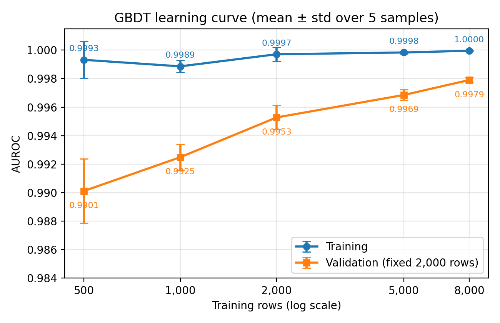

# Group 14 — Human or AI?

**Team members:** TODO (names + NetIDs)  
**Kaggle team name:** TODO

## Setup

Python 3.13 (3.10+ should work).

```bash
python -m venv .venv
.venv\Scripts\activate          # Windows; use `source .venv/bin/activate` on macOS/Linux
pip install -r requirements.txt
```

Place `train.csv`, `unlabeled.csv`, `test.csv` in `./data/` (not committed).

## Preprocessing → TF-IDF features

```bash
python preprocess.py --train data/train.csv --test data/test.csv --unlabeled data/unlabeled.csv --out-dir features
```

Writes `X_train.npz`, `X_test.npz` (sparse float32, 300,000 columns), `y_train.npy`, `test_ids.csv`, the fitted `vectorizer.joblib`, and `meta.json`.

To reproduce the representation comparison (5-fold stratified CV, ROC-AUC):

```bash
python ablate_features.py --train data/train.csv
```

### Normalization (`features.normalize_text`)

1. Unicode NFKC, strip zero-width characters / soft hyphens / control characters — undoes invisible-character and full-width tricks used in RAID-style adversarial attacks.
2. Replace every digit with `0` — keeps "there is a number here" but not the specific value.
3. Collapse runs of spaces/tabs to one space.
4. Replace each line/paragraph break with a `¶` token — line structure is the single most useful normalization step (see below).
5. **No lowercasing, no stop-word removal, no stemming, punctuation kept** — casing, function words, and punctuation are style signals, which is exactly what separates human from machine text.

### Features (`features.build_vectorizer`)

| View | Tokens | n-grams | Cap |
|---|---|---|---|
| Word TF-IDF | words + each punctuation mark as its own token | 1–2 | 100k, `min_df=2`, `max_df=0.95` |
| Char TF-IDF | raw characters (crossing word boundaries) | 2–5 | 200k, `min_df=2` |

Both use `sublinear_tf=True` (1 + log tf) and L2 normalization, and are horizontally concatenated. The vocabulary/IDF is fit on `train.csv` + `unlabeled.csv` text (no labels are used from unlabeled data).

### Validation results (TF-IDF + logistic regression, C=4, seed 20261023)

| Representation | ROC-AUC |
|---|---|
| sklearn default `TfidfVectorizer()` | 0.9033 |
| + bigrams, sublinear tf | 0.9403 |
| + punctuation tokens, cased | 0.9627 |
| + normalization with `¶` line-break token (final word view) | 0.9886 |
| char 2–5 only | 0.9897 |
| word + char_wb 3–5, lowercased | 0.9827 |
| word + char 2–5, lowercased | 0.9905 |
| **word + char 2–5, cased (final)** | **0.9918 ± 0.0016** |

Removing the `¶` token from the otherwise-final word view drops it to 0.9638, so paragraph/line formatting is a major signal.

## Fixed validation partition (shared by all models)

`val_ids.txt` lists the 2,000 `train.csv` ids held out for validation (stratified, 50% AI, seed `20261023`). Every model trains on the other 8,000 rows and reports AUROC on these 2,000:

```python
from split import load_split
train_df, val_df = load_split(pd.read_csv("data/train.csv"))
```

Fit any vocabulary/IDF/scaler on `train_df` (+ `unlabeled.csv` text) only, never on `val_df`.

## Model: Linear SVM

```bash
python train_svm.py --train data/train.csv --unlabeled data/unlabeled.csv --test data/test.csv --submission submission_svm.csv
```

`LinearSVC` (squared hinge loss, L2 penalty) on the word 1–2 + char 2–5 TF-IDF features. `C` is chosen by 5-fold CV AUROC on the 8,000 training rows over {0.03, 0.1, 0.3, 1, 3}; C=1 and C=3 tie at 0.9916, and the tie goes to the more regularized C=1. AUROC is computed from `decision_function` scores. For Kaggle, the model is refit on all 10,000 labeled rows and scores are mapped through a sigmoid (monotonic, so AUROC is unchanged).

| Model | Text representation | Train AUROC | Val. AUROC | Train time |
|---|---|---|---|---|
| Linear SVM (C=1) | word 1–2 + char 2–5 TF-IDF, 300k features | 1.0000 | 0.9941 | 2.1 s fit (171 s incl. TF-IDF) |

Results are also saved to `results_svm.json`.

## Preprocessing v2: blank-line aware (`features_v2.py`)

`features.normalize_text` collapses any run of line breaks into one `¶`, so `"a\n\nb"` and `"a\nb"` both become `a ¶ b`. In `train.csv` the two kinds of break separate the classes almost perfectly:

| Class | Passages with a blank line | Single line breaks / passage | Blank lines / passage |
|---|---|---|---|
| Human | 0.4% | 5.8 | 0.0 |
| AI | 66.3% | 2.6 | 4.8 |

`test.csv` has the same blank-line rate as `train.csv` (32.1% vs. 33.4% of passages), so the signal should carry over to Kaggle.

- `normalize_text_v2` is identical to v1 except it emits one `¶` per line break (`a ¶ ¶ b`). `build_vectorizer_v2` is the v1 word 1–2 + char 2–5 TF-IDF with that normalizer swapped in. `features.py` is unchanged, so the SVM numbers above stay reproducible.
- `stylometric_features` computes 37 per-passage statistics: counts of characters, words, sentences, paragraphs, line breaks and blank lines; mean/std of sentence, paragraph and word length; type-token and hapax ratios; function-word and repeated-bigram rates; upper-case, digit and capitalized-word rates; invisible-character count and non-ASCII rate; whether the passage ends in `.!?`; and 15 punctuation marks per 1k characters.

## Model: Gradient-boosted trees

```bash
python train_gbdt.py --train data/train.csv --unlabeled data/unlabeled.csv --test data/test.csv --submission submission_gbdt.csv
```

`HistGradientBoostingClassifier` on the 37 stylometric features + a 200-d LSA (`TruncatedSVD` of the v2 TF-IDF). TF-IDF and SVD are unsupervised and fit on the 8,000 training texts + `unlabeled.csv`. Hyperparameters are chosen by 5-fold CV AUROC on the 8,000 training rows over learning rate {0.05, 0.1} × max leaf nodes {15, 31, 63} × L2 {0, 1}. The number of trees is chosen by early stopping (`max_iter=1000`, internal 10% holdout, patience 30). All 12 settings score 0.9974–0.9981; the best is learning rate 0.1, 15 leaves, no L2 (CV AUROC 0.9981, 160 trees). For Kaggle, LSA and GBDT are refit on all 10,000 labeled rows and `predict_proba` is written as the score.

| Model | Text representation | Train AUROC | Val. AUROC | Train time |
|---|---|---|---|---|
| Linear SVM (C=1) | word 1–2 + char 2–5 TF-IDF (v1), 300k features | 1.0000 | 0.9941 | 2.1 s fit (171 s incl. TF-IDF) |
| GBDT (lr 0.1, 15 leaves, 160 trees) | 37 stylometric + 200-d LSA of v2 TF-IDF | 0.99995 | **0.9984** | 1.6 s fit (316 s incl. features) |

Ablation with the same hyperparameters: stylometric features only 0.9977, LSA only 0.9947. Permutation importance on the validation set: shuffling `n_blank_lines` drops AUROC by 0.150, and no other feature exceeds 0.005. The model is therefore mostly a blank-line detector with small corrections from vocabulary and LSA features. It exploits how the passages were formatted, not what they say, and would not survive reformatting (e.g. stripping blank lines).

Results are also saved to `results_gbdt.json`.

## Models: Linear SVM and logistic regression on v2 TF-IDF

```bash
python train_linear_v2.py --train data/train.csv --unlabeled data/unlabeled.csv --test data/test.csv
```

Same `LinearSVC` and `LogisticRegression` settings, C grids and validation protocol as `train_svm.py` and `train_logreg.py` (both unchanged). The only change is the normalizer, `normalize_text_v2`. The TF-IDF is built once and shared by both models. Writes `results_{svm,logreg}_v2.json` and `submission_{svm,logreg}_v2.csv`.

| Model | Preprocessing | C | 5-fold CV AUROC | Train AUROC | Val. AUROC | Train time |
|---|---|---|---|---|---|---|
| Linear SVM | v1 | 1 | 0.9916 | 1.0000 | 0.9941 | 2.1 s fit (171 s incl. TF-IDF) |
| Linear SVM | v2 | 3 | 0.9956 | 1.0000 | 0.9964 | 1.3 s fit (53 s incl. TF-IDF) |
| Logistic regression | v1 | 16 | 0.9910 | 1.0000 | 0.9938 | 10.1 s fit (192 s incl. TF-IDF) |
| Logistic regression | v2 | 16 | 0.9953 | 1.0000 | 0.9965 | 5.1 s fit (56 s incl. TF-IDF) |

The v1 rows are from `results_svm.json` and `results_logreg.json`, and their times are as recorded there. Rerun on the machine used for the v2 rows, the v1 models take 1.4 s (SVM) and 5.8 s (logistic regression) to fit and 54 s to build the TF-IDF, so the two normalizers cost the same.

## Effect of training-set size (GBDT)

```bash
python learning_curve.py --train data/train.csv --unlabeled data/unlabeled.csv
python plot_learning_curve.py --results results_learning_curve.json --out learning_curve.png
```

Trains the GBDT with the `results_gbdt.json` hyperparameters on 500 / 1,000 / 2,000 / 5,000 / 8,000 rows sampled from the training partition (stratified, nested across sizes, 5 repeats with seeds `20261023`–`20261027`) and scores the fixed 2,000-row validation set. The stylometric + LSA features are built once from the 8,000 training texts + `unlabeled.csv` (no labels), so only the number of labeled rows changes.

| Training rows | Train AUROC | Val. AUROC |
|---|---|---|
| 500 | 0.9993 ± 0.0013 | 0.9901 ± 0.0023 |
| 1,000 | 0.9989 ± 0.0004 | 0.9925 ± 0.0009 |
| 2,000 | 0.9997 ± 0.0005 | 0.9953 ± 0.0009 |
| 5,000 | 0.9998 ± 0.0001 | 0.9969 ± 0.0004 |
| 8,000 | 1.0000 ± 0.0000 | 0.9979 ± 0.0002 |



## Learning from unlabeled data (GBDT)

```bash
python unlabeled_experiment.py --train data/train.csv --unlabeled data/unlabeled.csv
```

Three arms with the `results_gbdt.json` hyperparameters, each trained with 5 seeds and scored on the fixed validation set. In the pseudo-label arm, the feature-learning model scores `unlabeled.csv`; rows with P(AI) ≥ 0.99 or ≤ 0.01 get that label and are added to the 8,000 training rows before refitting. The thresholds are fixed in advance, and the validation rows are never used to fit the TF-IDF/SVD or the teacher.

| Arm | TF-IDF/SVD fit on | Labeled rows | Val. AUROC |
|---|---|---|---|
| Supervised only | training text | 8,000 | 0.9977 ± 0.0001 |
| Feature learning (`train_gbdt.py`) | training + unlabeled text | 8,000 | 0.9979 ± 0.0004 |
| Feature learning + pseudo-labels | training + unlabeled text | 8,000 + ~2,710 pseudo | 0.9979 ± 0.0002 |

The differences are within seed noise. About 2,710 of the 3,000 unlabeled rows pass the thresholds (1,336 AI, 1,377 human); 75% of the pseudo-labeled AI rows contain a blank line, against 12% of the rejected rows. Under the same rule on the validation set, about 8 of 1,870 confident predictions are wrong, 7 of them AI passages called human. Results are saved to `results_unlabeled.json`.

## Blank-line augmentation (GBDT)

```bash
python blank_line_augment.py --train data/train.csv --unlabeled data/unlabeled.csv --test data/test.csv --submission submission_gbdt_aug.csv
```

Tests whether the GBDT depends too much on blank lines. The augmented model adds one copy of every training passage that contains a blank line, with its blank lines collapsed to single line breaks (2,677 copies, 2,659 AI). Features, TF-IDF/SVD and hyperparameters are the same as the baseline. Both are trained with 5 seeds and scored on the validation set as given, on the validation set with all blank lines collapsed ("stripped"), and on a hard slice (the 344 AI passages without a blank line vs. all 1,000 human passages).

| Model | Train rows | Val. AUROC | Stripped val. AUROC | Hard-slice AUROC | FN / FP at 0.5 | Trees | Fit time |
|---|---|---|---|---|---|---|---|
| Baseline | 8,000 | 0.9979 ± 0.0004 | 0.9861 ± 0.0015 | 0.9943 ± 0.0013 | 25 / 5 | 154 | 1.5 s |
| Augmented | 10,677 | 0.9988 ± 0.0001 | 0.9973 ± 0.0001 | 0.9968 ± 0.0002 | 13 / 10 | 280 | 2.8 s |

Results are saved to `results_blank_line_augment.json`. With `--test`, the augmented model is refit on all 10,000 labeled rows plus their stripped copies and written to `--submission`; add `--repeats 0` to skip the evaluation and only write the submission.

## Seeds

- Global seed: `20261023` (validation split, CV folds, LinearSVC, TruncatedSVD, gradient boosting).
- Learning curve: subsample seeds `20261023`–`20261027`.
- Unlabeled-data and blank-line-augmentation experiments: GBDT seeds `20261023`–`20261027` (mean ± std reported).

## AI assistance

TODO — preprocessing code and ablation were written with Cursor (AI agent); describe what you verified.
