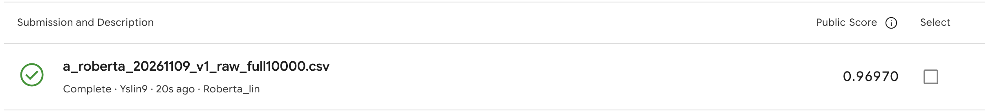

# RoBERTa public result — November 9, 2026

The user-provided Kaggle screenshot records **Public Score 0.96970** for
`a_roberta_20261109_v1_raw_full10000.csv`, status **Complete**, description
`Roberta_lin`. This is **+0.09571** versus the previously reported WC120 score
of 0.87399. RoBERTa is now the highest reported public candidate in this
repository; private-set performance has not been observed.

## Submitted model and local evidence

The raw-text RoBERTa-base candidate was refit from the generic pinned checkpoint
on all 10,000 supplied labels for two epochs in `python_course` on M4 Pro. Its
fixed recipe uses FP32 SDPA, 512 tokens, microbatch 4, accumulation 4, seed 42,
AdamW learning rate 2e-5 and weight decay 0.01. Original whitespace is preserved.
No test labels, external authorship labels, development-checkpoint warm start
or new parameter search are used.

The CSV contains 3,000 unique test IDs and P(AI=1), with exact original test
order. Schema, ID, finite-probability and independent evidence checks pass.
Saving/reloading the final model reproduces every test probability and margin
exactly (maximum error 0.0). Local CSV SHA256:

`c721fb356ab72315bab6c8499b3630391f4955e9429f8e359bdbc3d5896e781b`

The prior seven-fit development comparison records raw-text macro AUROCs of
0.996673 on matched random folds and 0.995652 on topic-proxy folds, versus WC120
0.965848/0.932745. The separate 8,000-trained model's reused 2,000-row development
AUROC is 0.999297. None of these values is a held-out score for the full-label
refit, and the public/private split is not a new estimate of training quality.

Whitespace sensitivity remains part of the evidence. On the same 1,627 eligible
development originals, the fixed 8,000-trained checkpoint gives prefix100 AUROC
0.990948 when original whitespace is retained versus 0.782456 after joining with
single spaces; no prefix is truncated at 512 tokens. This post-hoc diagnostic
does not invalidate the observed public gain or establish that inference-only
normalization would improve the submitted model.

## Provenance and interpretation

The score is transcribed from the supplied screenshot. Exact upload time,
submission ID and server-side CSV checksum are not independently available;
the displayed filename matches the verified local export. The displayed account
is `Yslin9`. No exact timestamp is inferred from the relative `20s ago` label.

The original export metadata and numeric experiment receipts are preserved as
historical snapshots. Subsequent feedback lives in
[`observation.json`](../results/supervised/a_roberta_public_20261109_v1_feedback/observation.json)
and [`leaderboard_log.csv`](../submissions/leaderboard_log.csv).

This is evidence that the tested RoBERTa submission improved the observed
public score. It does not isolate a causal effect of architecture/pretraining
from the whole model-family/recipe change, or establish private-score gains.

- [Submission CSV](../submissions/a_roberta_20261109_v1_raw_full10000.csv).
- [Full-label export evidence](../results/supervised/a_roberta_20261109_v1_raw_full10000/independent_verification.json).
- [Seven-fit comparison](roberta_context_results_20261109.md).
- [Same-word whitespace diagnostic](roberta_prefix_whitespace_results_20261109.md).
