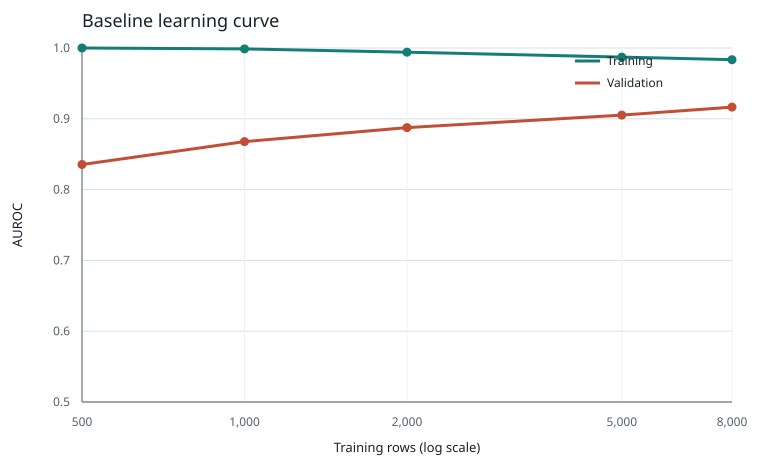

# Q1/Q2: model comparison and training size

## Protocol

- Code revision: `4f0f9289775a2521dd56f72fd70bf8d2a0b3088e`; seed: `42`; Python: `3.11.18`.
- Labeled data: 10,000 rows, 5,000 per class; SHA-256: `325e345faf88fb1c4203278098c282e40319a87b4bf17e094d2f235f51d0c07e`.
- Fixed validation: 2,000 rows, 1,000 per class; IDs from `validation_ids.json` (unchanged).
- Every pipeline fits its own vocabulary and IDF/count features on that run's training rows only. Model comparison uses the same fixed holdout; SVM AUROC uses decision margins, not probabilities.
- Candidate runtimes are fit-only seconds, repeated 3 times with one BLAS/OpenMP thread. Learning-curve runtimes are one fit per size.

## Q1: complete pipeline comparison

The feature representation varies by model family, so this is a comparison of complete pipelines. Hyperparameters were selected within each family by validation AUROC; no test rows were used.

| Pipeline | Parameters | Train AUROC | Validation AUROC | Fit seconds (min-max, 3 runs) |
|---|---:|---:|---:|---:|
| Logistic regression / word TF-IDF | `{"C": 0.1}` | 0.934675 | 0.890239 | 0.459-0.530 |
| Logistic regression / word TF-IDF | `{"C": 1.0}` | 0.983512 | 0.916527 | 0.491-0.530 |
| Logistic regression / word TF-IDF | `{"C": 10.0}` | 0.999985 | 0.920794 | 0.528-0.544 |
| Multinomial Naive Bayes / counts | `{"alpha": 0.01}` | 0.982391 | 0.790272 | 0.405-0.411 |
| Multinomial Naive Bayes / counts | `{"alpha": 0.1}` | 0.975622 | 0.805963 | 0.400-0.411 |
| Multinomial Naive Bayes / counts | `{"alpha": 1.0}` | 0.961073 | 0.823603 | 0.411-0.620 |
| Linear SVM / word TF-IDF | `{"C": 0.1}` | 0.983117 | 0.916757 | 0.453-0.515 |
| Linear SVM / word TF-IDF | `{"C": 1.0}` | 0.999994 | 0.917332 | 0.486-0.554 |
| Linear SVM / word TF-IDF | `{"C": 10.0}` | 1.000000 | 0.906552 | 0.553-0.566 |

Best candidate per family by validation AUROC:

- logistic_regression: `{"C": 10.0}`; train AUROC 0.999985, validation AUROC 0.920794.
- count_naive_bayes: `{"alpha": 1.0}`; train AUROC 0.961073, validation AUROC 0.823603.
- linear_svm: `{"C": 1.0}`; train AUROC 0.999994, validation AUROC 0.917332.

## Q2: baseline learning curve

The baseline settings are unchanged from `train.py`; the fixed validation set is reused. Each size uses a deterministic, class-balanced subset nested within larger sizes. The text pipeline is newly fitted for every size.

| Training rows | Train AUROC | Validation AUROC | Fit seconds | Vocabulary size |
|---:|---:|---:|---:|---:|
| 500 | 1.000000 | 0.835447 | 0.035 | 5,643 |
| 1,000 | 0.998756 | 0.867760 | 0.063 | 8,744 |
| 2,000 | 0.994065 | 0.887511 | 0.122 | 13,040 |
| 5,000 | 0.987116 | 0.905237 | 0.303 | 21,613 |
| 8,000 | 0.983512 | 0.916527 | 0.483 | 27,706 |



The x-axis is logarithmic. The chart and detailed CSVs are generated by `experiments.py`.

## Reproduction

From this directory, activate the Python 3.11 environment and run:

```sh
.venv/bin/python experiments.py --train /path/to/train.csv
```

Candidate results: `outputs/q1_q2/model_comparison.csv`; learning-curve values: `outputs/q1_q2/learning_curve.csv`.

AI assisted with the experiment implementation and generated report. Automated checks and scores are not represented as independent human verification; team review remains necessary. No final Kaggle model is selected here.
