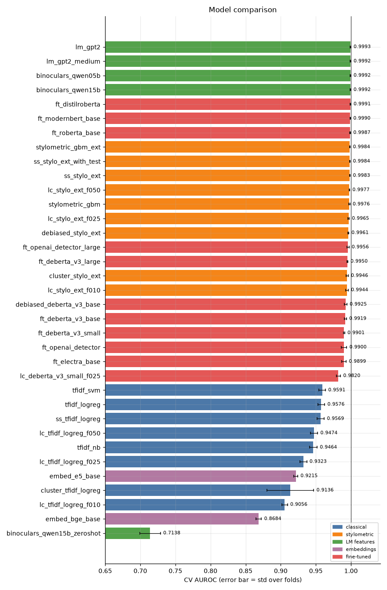
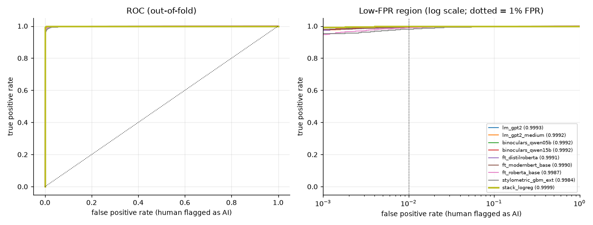
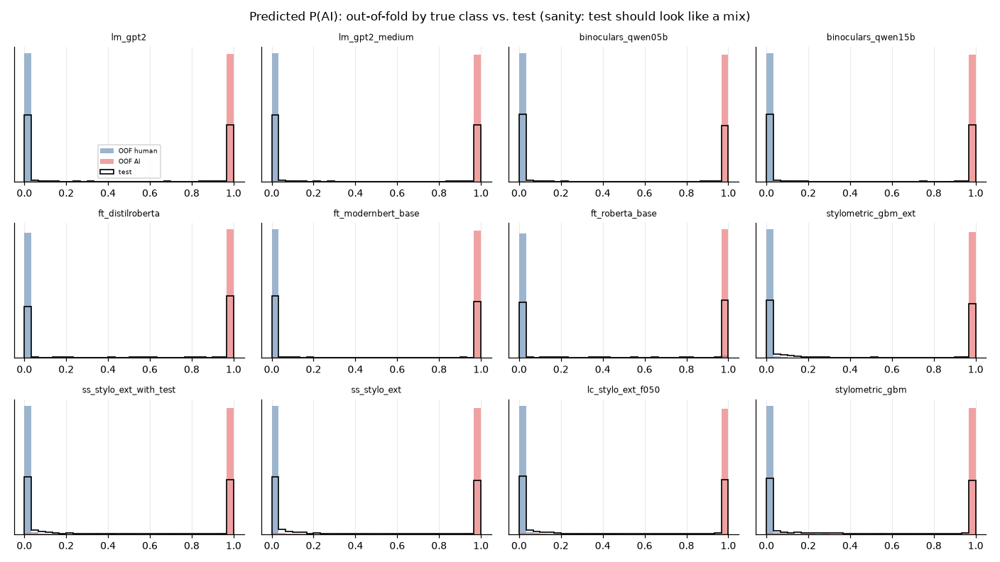
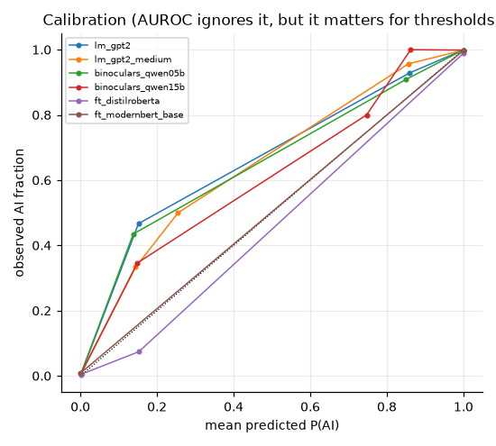
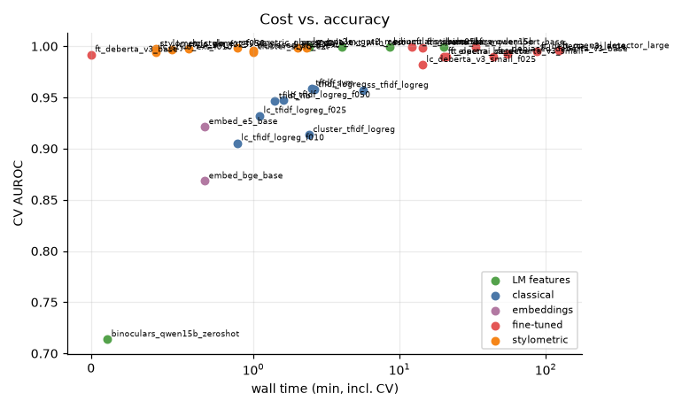
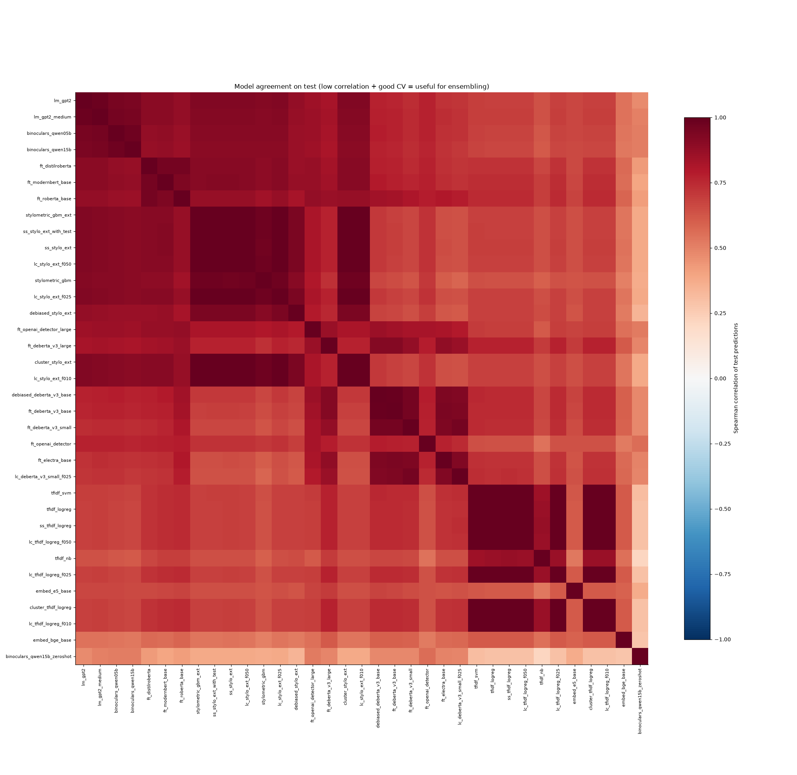
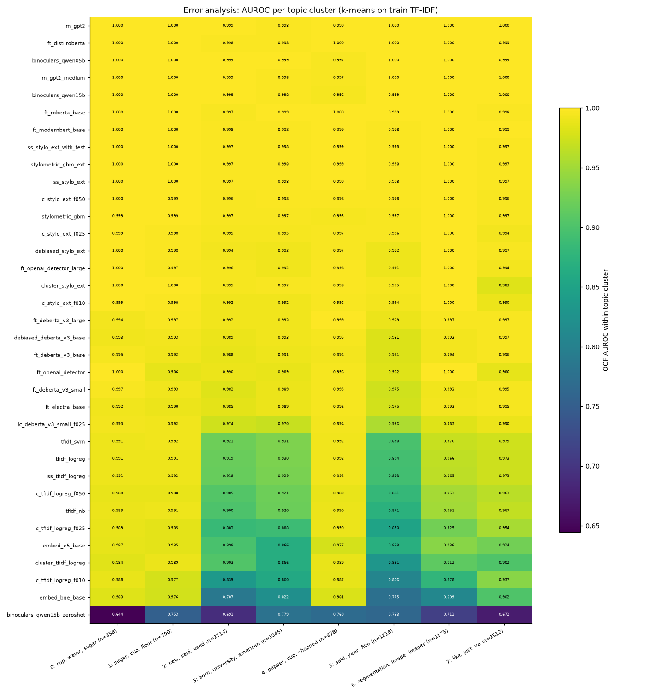
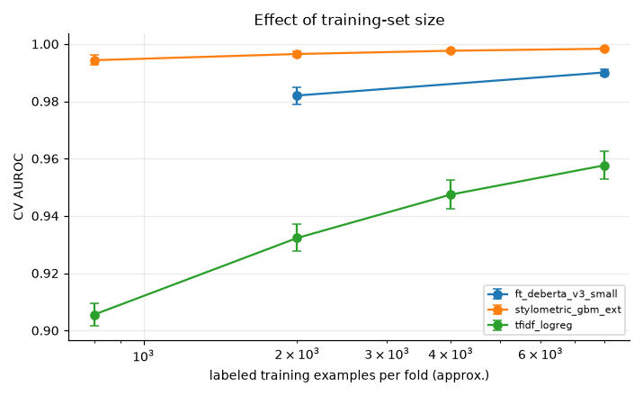

# Session `20261028-145019_pc`

Profile **pc** — Every model, 5-fold stratified CV, plus learning-curve, semi-supervised and robustness experiments.

Jobs: 35 ok, 0 failed, 0 not run.  Sanity checks: 0 FAIL, 3 WARN (details below).

## Recommended submission

**stack_logreg** — OOF AUROC 0.9999 on 10000 rows → `outputs/submissions/20261028-145019_pc__best.csv`

_Greedy and stacking scores are cross-validated (nested), so they are comparable to single models. Remember the test set contains unseen domains/generators — prefer robust gains over tiny CV gains._

## Results

| job | family | group | cv_scheme | n_folds | cv_auroc | fold_std | tpr@1%fpr | accuracy | log_loss | time_min | device | test_mean |
|---|---|---|---|---|---|---|---|---|---|---|---|---|
| lm_gpt2 | LM features | main | stratified | 5 | 0.9993 | 0.0004 | 0.9936 | 0.9921 | 0.0268 | 2.4 | NVIDIA GeForce RTX 5070 | 0.460 |
| lm_gpt2_medium | LM features | main | stratified | 5 | 0.9992 | 0.0005 | 0.9932 | 0.9914 | 0.0274 | 4.0 | NVIDIA GeForce RTX 5070 | 0.461 |
| binoculars_qwen05b | LM features | main | stratified | 5 | 0.9992 | 0.0005 | 0.9936 | 0.9930 | 0.0274 | 8.5 | NVIDIA GeForce RTX 5070 | 0.454 |
| binoculars_qwen15b | LM features | main | stratified | 5 | 0.9992 | 0.0005 | 0.9930 | 0.9921 | 0.0284 | 19.9 | NVIDIA GeForce RTX 5070 | 0.453 |
| ft_distilroberta | fine-tuned | main | stratified | 5 | 0.9991 | 0.0006 | 0.9920 | 0.9889 | 0.0489 | 12.2 | NVIDIA GeForce RTX 5070 | 0.539 |
| ft_modernbert_base | fine-tuned | main | stratified | 5 | 0.9990 | 0.0004 | 0.9930 | 0.9921 | 0.0383 | 32.9 | NVIDIA GeForce RTX 5070 | 0.468 |
| ft_roberta_base | fine-tuned | main | stratified | 5 | 0.9987 | 0.0006 | 0.9894 | 0.9846 | 0.0776 | 14.4 | NVIDIA GeForce RTX 5070 | 0.506 |
| stylometric_gbm_ext | stylometric | main | stratified | 5 | 0.9984 | 0.0005 | 0.9812 | 0.9853 | 0.0472 | 0.9 | cpu | 0.458 |
| ss_stylo_ext_with_test | stylometric | semi_supervised | stratified | 5 | 0.9984 | 0.0005 | 0.9804 | 0.9846 | 0.0474 | 2.3 | cpu | 0.461 |
| ss_stylo_ext | stylometric | semi_supervised | stratified | 5 | 0.9983 | 0.0005 | 0.9800 | 0.9842 | 0.0477 | 2.0 | cpu | 0.458 |
| lc_stylo_ext_f050 | stylometric | learning_curve | stratified | 5 | 0.9977 | 0.0005 | 0.9764 | 0.9814 | 0.0567 | 0.6 | cpu | 0.458 |
| stylometric_gbm | stylometric | main | stratified | 5 | 0.9976 | 0.0009 | 0.9740 | 0.9821 | 0.0539 | 0.4 | cpu | 0.473 |
| lc_stylo_ext_f025 | stylometric | learning_curve | stratified | 5 | 0.9965 | 0.0009 | 0.9620 | 0.9762 | 0.0695 | 0.5 | cpu | 0.458 |
| debiased_stylo_ext | stylometric | robustness | stratified | 5 | 0.9961 | 0.0007 | 0.9422 | 0.9747 | 0.0747 | 1.0 | cpu | 0.522 |
| ft_openai_detector_large | fine-tuned | main | stratified | 5 | 0.9956 | 0.0015 | 0.9556 | 0.9512 | 0.2176 | 122.1 | NVIDIA GeForce RTX 3060 | 0.550 |
| ft_deberta_v3_large | fine-tuned | main | stratified | 5 | 0.9950 | 0.0005 | 0.9398 | 0.9624 | 0.1312 | 87.2 | NVIDIA GeForce RTX 5070 | 0.482 |
| cluster_stylo_ext | stylometric | robustness | cluster | 5 | 0.9946 | 0.0014 | 0.9338 | 0.9691 | 0.0969 | 1.0 | cpu | 0.458 |
| lc_stylo_ext_f010 | stylometric | learning_curve | stratified | 5 | 0.9944 | 0.0017 | 0.9384 | 0.9696 | 0.0899 | 0.4 | cpu | 0.458 |
| debiased_deberta_v3_base | fine-tuned | robustness | stratified | 5 | 0.9925 | 0.0017 | 0.9252 | 0.9132 | 0.3545 | 55.0 | NVIDIA GeForce RTX 5070 | 0.537 |
| ft_deberta_v3_base | fine-tuned | main | stratified | 5 | 0.9919 | 0.0017 | 0.9114 | 0.9130 | 0.3610 | 0.0 | NVIDIA GeForce RTX 5070 | 0.528 |
| ft_deberta_v3_small | fine-tuned | main | stratified | 5 | 0.9901 | 0.0010 | 0.8862 | 0.8982 | 0.4600 | 44.0 | NVIDIA GeForce RTX 5070 | 0.554 |
| ft_openai_detector | fine-tuned | main | stratified | 5 | 0.9900 | 0.0038 | 0.6296 | 0.9604 | 0.2133 | 21.0 | NVIDIA GeForce RTX 5070 | 0.535 |
| ft_electra_base | fine-tuned | main | stratified | 5 | 0.9899 | 0.0032 | 0.8882 | 0.9021 | 0.4092 | 20.1 | NVIDIA GeForce RTX 5070 | 0.535 |
| lc_deberta_v3_small_f025 | fine-tuned | learning_curve | stratified | 5 | 0.9820 | 0.0029 | 0.8438 | 0.8778 | 0.3780 | 14.3 | NVIDIA GeForce RTX 5070 | 0.527 |
| tfidf_svm | classical | main | stratified | 5 | 0.9591 | 0.0046 | 0.7082 | 0.8972 | 0.4504 | 2.5 | cpu | 0.476 |
| tfidf_logreg | classical | main | stratified | 5 | 0.9576 | 0.0049 | 0.7170 | 0.8944 | 0.2824 | 2.6 | cpu | 0.441 |
| ss_tfidf_logreg | classical | semi_supervised | stratified | 5 | 0.9569 | 0.0049 | 0.7136 | 0.8924 | 0.2796 | 5.6 | cpu | 0.438 |
| lc_tfidf_logreg_f050 | classical | learning_curve | stratified | 5 | 0.9474 | 0.0050 | 0.6646 | 0.8808 | 0.3242 | 1.6 | cpu | 0.441 |
| tfidf_nb | classical | main | stratified | 5 | 0.9464 | 0.0054 | 0.6376 | 0.8744 | 0.3593 | 1.4 | cpu | 0.453 |
| lc_tfidf_logreg_f025 | classical | learning_curve | stratified | 5 | 0.9323 | 0.0047 | 0.6032 | 0.8612 | 0.3742 | 1.1 | cpu | 0.441 |
| embed_e5_base | embeddings | main | stratified | 5 | 0.9215 | 0.0027 | 0.4092 | 0.8486 | 0.3817 | 0.7 | NVIDIA GeForce RTX 5070 | 0.511 |
| cluster_tfidf_logreg | classical | robustness | cluster | 5 | 0.9136 | 0.0333 | 0.5006 | 0.8382 | 0.3857 | 2.4 | cpu | 0.441 |
| lc_tfidf_logreg_f010 | classical | learning_curve | stratified | 5 | 0.9056 | 0.0040 | 0.4812 | 0.8301 | 0.4472 | 0.9 | cpu | 0.441 |
| embed_bge_base | embeddings | main | stratified | 5 | 0.8684 | 0.0040 | 0.2816 | 0.7904 | 0.4751 | 0.7 | NVIDIA GeForce RTX 5070 | 0.521 |
| binoculars_qwen15b_zeroshot | LM features | main | stratified | 5 | 0.7138 | 0.0148 | 0.4996 | 0.6878 | 0.6404 | 0.1 | NVIDIA GeForce RTX 5070 | 0.527 |

## Ensembles

| method | auroc | tpr@1%fpr | rows_evaluated | members |
|---|---|---|---|---|
| stack_logreg | 0.9999 | 0.9982 | 10000 | lm_gpt2:-0.07 + lm_gpt2_medium:+0.22 + binoculars_qwen05b:+0.37 + binoculars_qwen15b:+0.05 + ft_distilroberta:+0.13 + ft_modernbert_base:+0.07 + ft_roberta_base:+0.12 + stylometric_gbm_ext:+0.30 + stylometric_gbm:-0.38 + ft_openai_detector_large:+0.00 + ft_deberta_v3_large:+0.29 + ft_deberta_v3_base:-0.06 + ft_deberta_v3_small:-0.04 + ft_openai_detector:+0.20 + ft_electra_base:-0.11 + tfidf_svm:+0.09 + tfidf_logreg:+0.10 + tfidf_nb:+0.27 + embed_e5_base:-0.21 + embed_bge_base:-0.14 + binoculars_qwen15b_zeroshot:-0.43 |
| greedy_selection | 0.9997 | 0.9972 | 10000 | lm_gpt2:0.27 + stylometric_gbm_ext:0.17 + ft_distilroberta:0.10 + ft_openai_detector:0.10 + ft_deberta_v3_large:0.10 + binoculars_qwen05b:0.07 + ft_modernbert_base:0.07 + ft_openai_detector_large:0.07 + binoculars_qwen15b:0.03 + ft_deberta_v3_base:0.03 |
| rank_mean_top5 | 0.9996 | 0.9972 | 10000 | lm_gpt2 + lm_gpt2_medium + binoculars_qwen05b + binoculars_qwen15b + ft_distilroberta |
| rank_mean_all | 0.9994 | 0.9908 | 10000 | 21 models |
| single_best (lm_gpt2) | 0.9993 | 0.9936 | 10000 | lm_gpt2 |

## Learning curve runs

| job | config | cv_scheme | train_frac | cv_auroc | baseline_cv_auroc | delta |
|---|---|---|---|---|---|---|
| lc_tfidf_logreg_f010 | tfidf_logreg | stratified | 0.1000 | 0.9056 | 0.9576 | -0.0521 |
| lc_tfidf_logreg_f025 | tfidf_logreg | stratified | 0.2500 | 0.9323 | 0.9576 | -0.0253 |
| lc_tfidf_logreg_f050 | tfidf_logreg | stratified | 0.5000 | 0.9474 | 0.9576 | -0.0102 |
| lc_stylo_ext_f010 | stylometric_gbm_ext | stratified | 0.1000 | 0.9944 | 0.9984 | -0.0040 |
| lc_stylo_ext_f025 | stylometric_gbm_ext | stratified | 0.2500 | 0.9965 | 0.9984 | -0.0018 |
| lc_stylo_ext_f050 | stylometric_gbm_ext | stratified | 0.5000 | 0.9977 | 0.9984 | -0.0007 |
| lc_deberta_v3_small_f025 | ft_deberta_v3_small | stratified | 0.2500 | 0.9820 | 0.9901 | -0.0080 |

## Semi-supervised runs

| job | config | cv_scheme | train_frac | cv_auroc | baseline_cv_auroc | delta |
|---|---|---|---|---|---|---|
| ss_tfidf_logreg | tfidf_logreg | stratified | 1.0000 | 0.9569 | 0.9576 | -0.0007 |
| ss_stylo_ext | stylometric_gbm_ext | stratified | 1.0000 | 0.9983 | 0.9984 | -0.0000 |
| ss_stylo_ext_with_test | stylometric_gbm_ext | stratified | 1.0000 | 0.9984 | 0.9984 | -0.0000 |

## Robustness / generalisation runs

| job | config | cv_scheme | train_frac | cv_auroc | baseline_cv_auroc | delta |
|---|---|---|---|---|---|---|
| cluster_tfidf_logreg | tfidf_logreg | cluster | 1.0000 | 0.9136 | 0.9576 | -0.0440 |
| cluster_stylo_ext | stylometric_gbm_ext | cluster | 1.0000 | 0.9946 | 0.9984 | -0.0038 |
| debiased_stylo_ext | stylometric_gbm_ext | stratified | 1.0000 | 0.9961 | 0.9984 | -0.0023 |
| debiased_deberta_v3_base | ft_deberta_v3_base | stratified | 1.0000 | 0.9925 | 0.9919 | 0.0006 |

## Figures

### Model comparison

### ROC curves

### Score distributions

### Calibration

### Cost vs accuracy

### Model agreement

### Per-topic AUROC

### Learning curve

## Sanity checks

0 FAIL, 3 WARN, 314 PASS.

| scope | check | result | detail |
|---|---|---|---|
| binoculars_qwen15b_zeroshot | CV AUROC > 0.75 (model learned something) | WARN | 0.7138 |
| lc_stylo_ext_f010 | test score distribution close to OOF distribution (KS < 0.25) | WARN | KS 0.258 - large values mean distribution shift or a preprocessing mismatch |
| cluster_tfidf_logreg | fold AUROC spread small (std < 0.03) | WARN | std 0.0333 |

Full list: `sanity.csv`. Summary of every job and metric: `summary.csv`.
