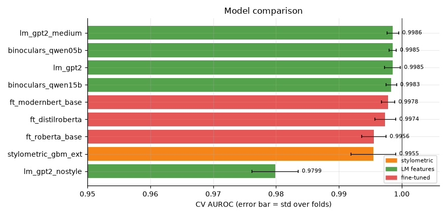
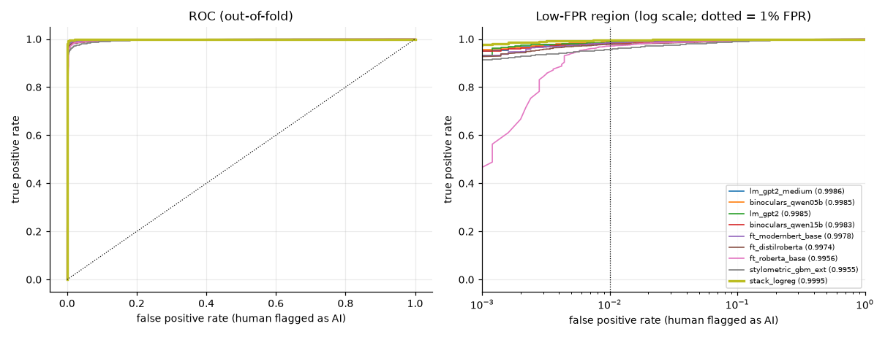
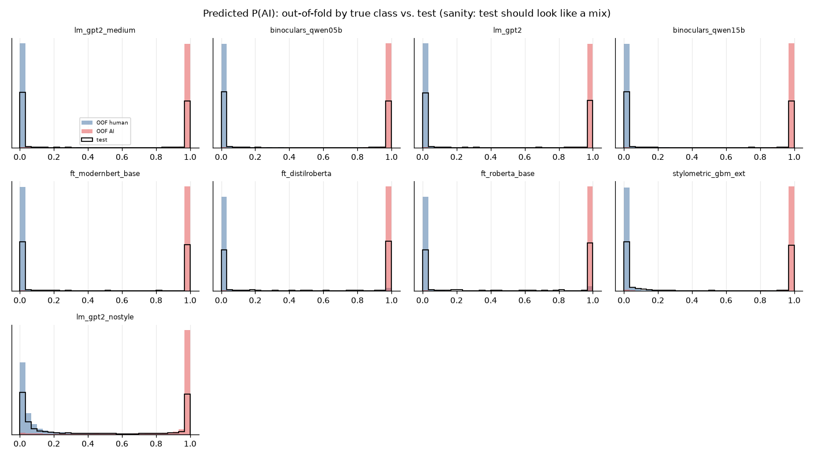
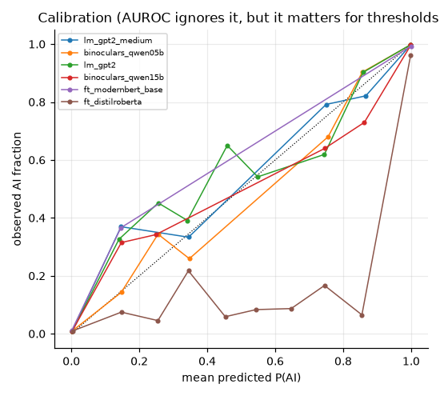
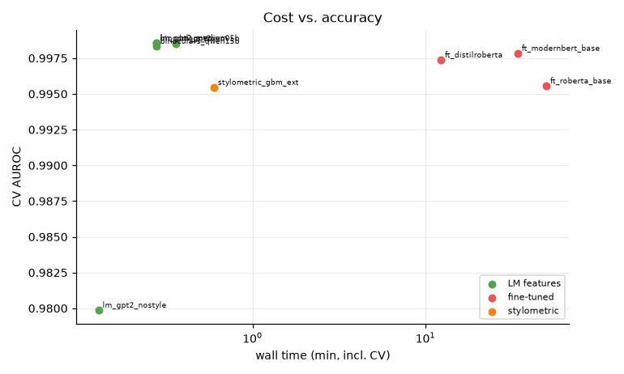
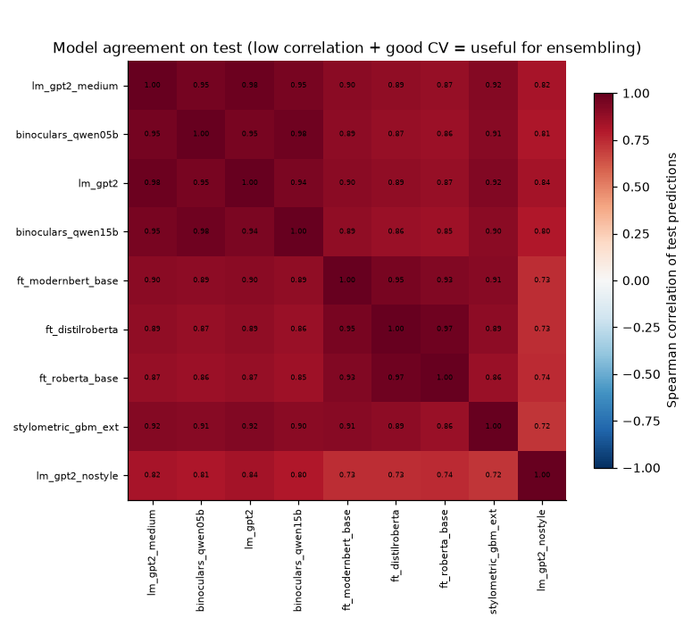
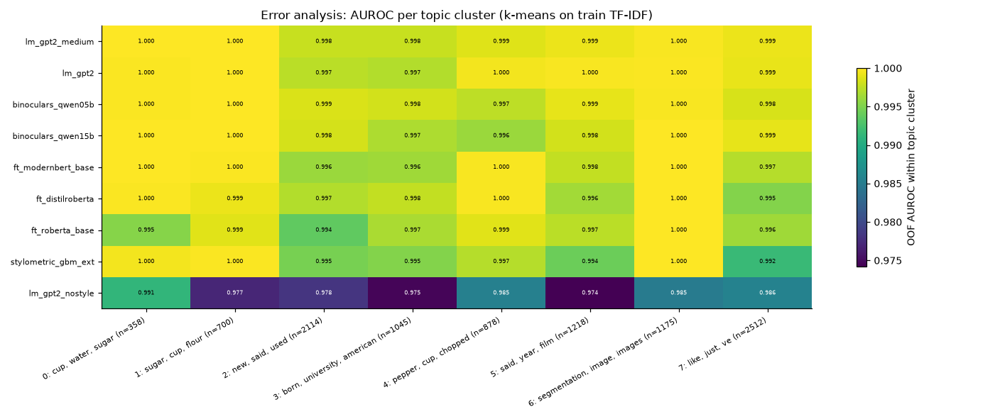

# Session `20261110-173530_topic_cv`

Profile **topic_cv** — Topic-held-out CV of the blend candidates (train.csv only), for blend selection.

Jobs: 9 ok, 0 failed, 0 not run.  Sanity checks: 0 FAIL, 0 WARN (details below).

## Recommended submission

**stack_logreg** — OOF AUROC 0.9995 on 10000 rows → `outputs/submissions/20261110-173530_topic_cv__best.csv`

_Greedy and stacking scores are cross-validated (nested), so they are comparable to single models. Remember the test set contains unseen domains/generators — prefer robust gains over tiny CV gains._

## Results

| job | family | group | cv_scheme | n_folds | cv_auroc | fold_std | tpr@1%fpr | accuracy | log_loss | time_min | device | test_mean |
|---|---|---|---|---|---|---|---|---|---|---|---|---|
| lm_gpt2_medium | LM features | main | cluster | 5 | 0.9986 | 0.0009 | 0.9848 | 0.9871 | 0.0416 | 0.5 | NVIDIA GeForce RTX 5070 | 0.461 |
| binoculars_qwen05b | LM features | main | cluster | 5 | 0.9985 | 0.0006 | 0.9856 | 0.9882 | 0.0409 | 0.5 | NVIDIA GeForce RTX 5070 | 0.454 |
| lm_gpt2 | LM features | main | cluster | 5 | 0.9985 | 0.0013 | 0.9854 | 0.9874 | 0.0403 | 0.6 | NVIDIA GeForce RTX 5070 | 0.460 |
| binoculars_qwen15b | LM features | main | cluster | 5 | 0.9983 | 0.0008 | 0.9824 | 0.9863 | 0.0459 | 0.5 | NVIDIA GeForce RTX 5070 | 0.453 |
| ft_modernbert_base | fine-tuned | main | cluster | 5 | 0.9978 | 0.0011 | 0.9842 | 0.9869 | 0.0689 | 34.2 | NVIDIA GeForce RTX 5070 | 0.476 |
| ft_distilroberta | fine-tuned | main | cluster | 5 | 0.9974 | 0.0017 | 0.9780 | 0.9640 | 0.1350 | 12.3 | NVIDIA GeForce RTX 5070 | 0.530 |
| ft_roberta_base | fine-tuned | main | cluster | 5 | 0.9956 | 0.0020 | 0.9708 | 0.9622 | 0.1794 | 50.0 | NVIDIA GeForce RTX 3060 | 0.525 |
| stylometric_gbm_ext | stylometric | main | cluster | 5 | 0.9955 | 0.0036 | 0.9560 | 0.9746 | 0.0803 | 0.8 | cpu | 0.458 |
| lm_gpt2_nostyle | LM features | main | cluster | 5 | 0.9799 | 0.0037 | 0.8564 | 0.9350 | 0.1676 | 0.2 | NVIDIA GeForce RTX 5070 | 0.429 |

## Ensembles

| method | auroc | tpr@1%fpr | rows_evaluated | members |
|---|---|---|---|---|
| stack_logreg | 0.9995 | 0.9950 | 10000 | lm_gpt2_medium:-0.02 + binoculars_qwen05b:+0.22 + lm_gpt2:+0.11 + binoculars_qwen15b:+0.17 + ft_modernbert_base:+0.23 + ft_distilroberta:+0.13 + ft_roberta_base:-0.02 + stylometric_gbm_ext:-0.13 + lm_gpt2_nostyle:+0.32 |
| rank_mean_all | 0.9993 | 0.9924 | 10000 | 9 models |
| greedy_selection | 0.9992 | 0.9928 | 10000 | binoculars_qwen05b:0.30 + ft_distilroberta:0.20 + ft_modernbert_base:0.13 + lm_gpt2_nostyle:0.13 + lm_gpt2_medium:0.07 + ft_roberta_base:0.07 + binoculars_qwen15b:0.07 + lm_gpt2:0.03 |
| rank_mean_top5 | 0.9991 | 0.9930 | 10000 | lm_gpt2_medium + binoculars_qwen05b + lm_gpt2 + binoculars_qwen15b + ft_modernbert_base |
| single_best (lm_gpt2_medium) | 0.9986 | 0.9848 | 10000 | lm_gpt2_medium |

## Figures

### Model comparison

### ROC curves

### Score distributions

### Calibration

### Cost vs accuracy

### Model agreement

### Per-topic AUROC

## Sanity checks

0 FAIL, 0 WARN, 83 PASS.

All checks passed.

Full list: `sanity.csv`. Summary of every job and metric: `summary.csv`.
