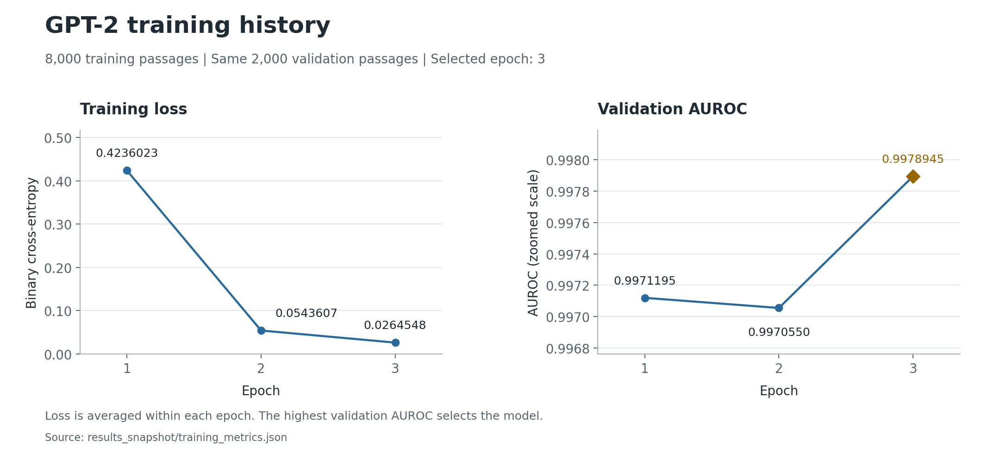
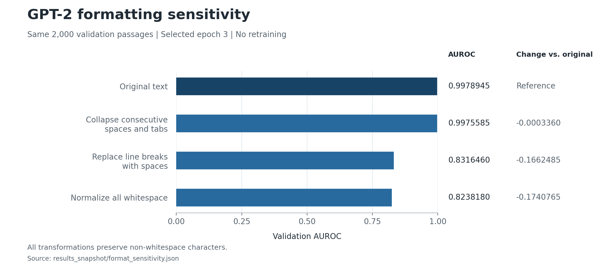

# GPT-2 Text Classification

Fine-tune `openai-community/gpt2` with one classification logit to predict the probability of AI-generated text. Label `1` means AI-generated and label `0` means human-written.

## Setup

Use Python 3.12 and a CUDA GPU. From `submissions/group-number-34/gpt2/`:

```bash
python3.12 -m venv .venv
source .venv/bin/activate
python -m pip install -r code/requirements.txt
```

Place `train.csv`, `test.csv`, and `sample_submission.csv` in the team directory's `data/` folder, one level above `gpt2/`.

## Train and validate

```bash
bash code/run.sh ../data ./results
```

The saved IDs in `code/val_ids.csv` define a stratified validation set of 2,000 rows, with 1,000 examples per class. The other 8,000 rows are used for training. The split and training seed are `42`.

Training runs for three epochs with maximum length `512`, batch size `4`, gradient accumulation `4`, effective batch size `16`, learning rate `2e-5`, weight decay `0.01`, 10% linear warmup, gradient clipping `1.0`, and FP16 autocast. All model parameters are updated using binary cross-entropy. Validation AUROC selects the saved model used for test predictions.

## Generate predictions

The training command generates `results/submission.csv`. To regenerate it from the selected model:

```bash
python code/predict.py \
  --checkpoint results/best_checkpoint.json \
  --test_csv ../data/test.csv \
  --sample_submission ../data/sample_submission.csv \
  --output results/submission.csv \
  --device cuda --batch_size 4 --max_length 512
```

The output contains `id,label` columns and 3,000 probabilities in the sample submission's ID order.

## Recorded results

| Epoch | Training loss | Validation AUROC |
| --- | ---: | ---: |
| 1 | 0.4236023 | 0.9971195 |
| 2 | 0.0543607 | 0.9970550 |
| 3 | 0.0264548 | 0.9978945 |

Epoch 3 was selected. Its Kaggle public AUROC is **0.94864**. Measurements and the submission checksum are recorded in `results_snapshot/`.



The two panels use separate scales. The AUROC panel uses a zoomed vertical axis and labels each measured value; the diamond marks the selected epoch.

## Formatting sensitivity

Evaluate the selected epoch-3 model on the same validation IDs:

```bash
python format_sensitivity.py \
  --project . --data ../data \
  --work /tmp/gpt2-format-check-01
```

Use a new work directory for each run. This command performs inference and writes the measurements under `format_sensitivity/`.

| Text transformation | Validation AUROC |
| --- | ---: |
| Original text | 0.9978945 |
| Collapse consecutive spaces and tabs | 0.9975585 |
| Replace line breaks with spaces | 0.8316460 |
| Normalize all whitespace | 0.8238180 |

The transformations preserve every non-whitespace character. Original predictions reproduce the saved results. The common subset of 1,992 untruncated passages shows similar AUROC reductions. The model is particularly sensitive to line-break formatting.



All four measurements use the same epoch-3 model and validation passages. Changes are absolute AUROC differences from the original text.

## Reproduce the figures

From this directory:

```bash
python -m pip install -r requirements-plots.txt
python plot_results.py
```

The script reads the two recorded JSON files in `results_snapshot/` and exports PNG and SVG versions to `figures/`. It requires no dataset, model checkpoint, or GPU.
