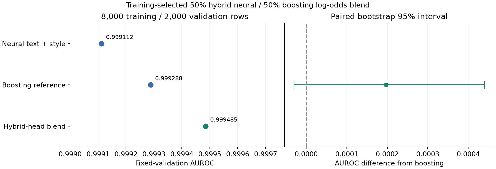

# Blending the text/style neural head with the strongest booster

## Measured result

The user reported **0.98267 public Kaggle AUROC** for the recommended blend on
November 5, 2026. This is below the previously reported team best of **0.98544**
by **0.00277**. See `kaggle_result.json`; the score was supplied in chat and was
not independently retrieved from Kaggle. The private score is unknown.

This candidate has not improved the reported public team best. The comparison
does not isolate whether the neural component helps: the teammate's newer
boosting model is different from this blend's older boosting reference, and its
code and predictions have not yet been inspected. Small changes to this blend
do not currently justify more public trials without additional evidence.

The hybrid neural head plus boosting reached **0.999485 validation AUROC**,
numerically exceeding the strongest committed boosting reference's **0.999288**.
The point gain is 0.000197; its paired bootstrap 95% difference interval is
[-0.000030, 0.000440]. The interval includes zero, so this does not establish a
reliable population improvement or a better public Kaggle score.

The inner-holdout result was **0.999748**, versus 0.998822 for the inner booster
and 0.999473 for the hybrid neural head. Both maximum-AUROC and conservative
selection chose the same 50% neural / 50% boosting mixture in log-odds space,
so only one distinct selected weight was evaluated on fixed validation.
No validation weight sweep was performed.

On these validation passages, the blend reverses 515 human/AI pairs versus the
booster's 712 (out of one million). It corrects 390 of the booster's reversed
pairs and introduces 193 reversals, for a net reduction of 197. At the unchanged
0.5 classification threshold, it makes ten errors versus the booster's 24.
These are diagnostics on this split, not a public-score guarantee. See
`error_summary.json` and `layout_subgroups.csv`.

## Checked submission

The [candidate CSV](../../submissions/deberta_hybrid_blend_maximum_8000.csv) is
ready, with its adjacent JSON manifest. It contains exactly 3,000 unique test IDs
in original order and finite probabilities in [0,1]. Every model uses the
8,000-row training partition; this is not a final refit on all 10,000 labels.
The export tools did not upload to Kaggle or push to GitHub. The user later
reported the public submission result above. The adjacent manifest and original
verification record retain their historical state at export time.

The saved neural heads reproduce the recorded validation component, and the
exported probabilities reconstruct from the saved test components. Source/data
hashes, unchanged split, encoder/head provenance, output hash, and the five new
passing selection/sampling tests are recorded in `verification.json` and
`test_provenance.json`. The parallel matched run completed 800 optimizer updates
with zero overflow skips, but retained the old 20% raw-DeBERTa blend; sampled
boosting and compressed-feature alternatives did not beat this hybrid-head blend.



## Method and reproduction

The selected three-seed text/style neural head is reconstructed on the 6,400
fitting rows. Its 1,600-row held-out AUROC must reproduce the original selection
score before any blend is selected. The neural probability mean is converted to
log-odds and combined with the original booster's log-odds. Maximum and
conservative one-bootstrap-SE weights use this training-only holdout; identical
weights are deduplicated. Only those selected weights are evaluated on fixed
validation. The full grid is not swept over validation.

All final base models remain trained on 8,000 rows, excluding fixed validation.
The encoder remains frozen. The project has reused fixed validation across its
experiments; its internal scores are not fresh-test estimates. The later public
score is user-reported, as documented above.

```bash
python -m experiments.deberta_hybrid_blend --stage compare
```

If a candidate wins, after other GPU work finishes:

```bash
python -m experiments.deberta_hybrid_blend --stage scores
python -m experiments.deberta_hybrid_blend --stage submit
```

Any export is checked and trained on 8,000 rows, not all 10,000 labeled examples.
Codex implemented the experiment. No external labeled data, Kaggle upload, or
Git push is used.
