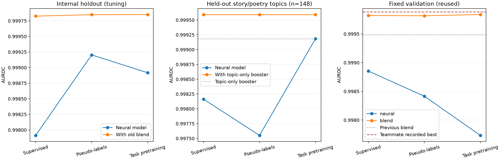

# RoBERTa and unlabeled-data experiments

Status: **complete**. All 21 training epochs across the three contexts completed
on the Mac GPU. Five integration tests, both real GPU smoke tests, encoder/head
transfer checks, and the completed-run artifact audit passed. `run.log` contains
the full run; `verification.json` records the checks. No Kaggle upload or Git
push was performed.

## Later public Kaggle result

The user reported **0.98256 public AUROC** for the recommended TAPT blend on
November 5, 2026. This is **0.00011 below** the previous DeBERTa/style/boosting
blend's 0.98267 and **0.00288 below** the previously reported team best of
0.98544. See `kaggle_result.json`. The score was supplied in chat, not independently
retrieved from Kaggle; the private score is unknown. The export manifest and
original verification retain their historical state before that user upload.

The fixed-validation point improvement did not translate into a public-score
improvement in this trial. The small public drop does not establish a reliable
population difference or that every RoBERTa approach would hurt. It gives no
reason to spend further public submissions on nearby variants of this old-base
blend. A distinct next experiment would use the teammate's newer GPT-2/curvature
model as the reference and assess whether supervised RoBERTa adds complementary
information, with training-only selection and appropriate held-out scores.

## Final results

All primary blend weights and checkpoints were chosen before fixed-validation
evaluation. Each new blend adds 20% RoBERTa log-odds to the previous frozen
DeBERTa/style/boosting blend. The supervised blend retained epoch 1; the other
two retained epoch 2. The shared learning-rate horizon remained two epochs.

| Method | Internal blend AUROC | Topic-held-out blend AUROC | Fixed-validation blend AUROC |
| --- | ---: | ---: | ---: |
| Supervised RoBERTa | 0.9998250000 | 0.9995918367 | 0.999821 |
| Filtered pseudo-labels | 0.9998484375 | 0.9995918367 | 0.999817 |
| Task-adaptive pretraining (preselected) | **0.9998500000** | 0.9995918367 | **0.999837** |

The previous blend's fixed-validation AUROC was **0.999485**. The primary TAPT
blend improves the point estimate by **0.000352**, with a paired bootstrap 95%
difference interval **[-0.000023, 0.001103]**. The interval includes zero and
conditions on this reused split and fitted models; it does not establish a
reliable population improvement. The TAPT blend corrects 376 of the previous
blend's reversed human/AI pairs and introduces 24, reducing the total from 515
to 163 out of one million. Threshold-0.5 errors fall from 10 to 8. Its advantage
over the supervised RoBERTa blend is just 16 ranked pairs, not a decisive win.

The 0.9999 target was **not reached**. The best new blend is numerically above
the teammate's recorded curvature/bagging validation score **0.999775**, but
below the stronger GPT-2/DistilRoBERTa stack's **0.999884**. Those teammate runs
have not been independently reproduced locally. The later user-reported public
score was **0.98256**, as documented above; the private score remains unknown.

### Did unlabeled data improve the neural model itself?

The supplementary two-epoch comparison gives every neural model equal
supervised exposure:

| Neural model, two passes | Inner AUROC | Topic-held-out AUROC | Fixed-validation AUROC |
| --- | ---: | ---: | ---: |
| Supervised | 0.9984859375 | **0.9993877551** | **0.998899** |
| Pseudo-labels | **0.9992031250** | 0.9975510204 | 0.998415 |
| Task pretraining | 0.9989171875 | 0.9991836735 | 0.997733 |

Thus the internal gains from unlabeled data did not carry through to a higher
standalone AUROC on fixed validation. The paired 95% differences from the
two-pass control were [-0.001739, 0.000221] for pseudo-labels and
[-0.002888, 0.000107] for TAPT, both including zero. This is one seed and one
configuration per method, so it does not establish that unlabeled data is
generally harmful. TAPT instead supplied slightly more complementary scores
for the ensemble. Most of the blend improvement came from adding RoBERTa at all.

The inner teachers accepted 2,652/3,000 unlabeled rows (57/67 story/poetry-like
rows); topic-excluded teachers accepted 2,668; final 8,000-row teachers accepted
2,661. The fixed filter accepted 1,418/1,600 mock-unlabeled inner examples and
126/148 held-out-topic examples with no incorrect accepted hard labels in those
checks. Their finite, reused samples do not guarantee perfect real-pool labels.

### Checked candidate

[`roberta_tapt_blend_8000.csv`](../../submissions/roberta_tapt_blend_8000.csv)
contains 3,000 unique test IDs in original order and finite AI probabilities.
The blend is 20% TAPT RoBERTa, 40% the earlier DeBERTa/style neural classifier,
and 40% the earlier booster in log-odds space. Every classifier uses 8,000
labeled fitting rows; the TAPT encoder additionally uses the 3,000 unlabeled
passages without labels. This is not a full 10,000-label refit.

Candidate SHA256:
`8c7e00f747a8284fa9065c6acfee964f34a5698f4b6d16689502813255bb55f0`

The candidate was exported by the frozen gate and subsequently tested by the
user, who reported the public score above. It did not establish an upgrade over
the latest team model. The three nearly tied variants do not warrant three
public trials. The agent performed no upload.



## Controlled comparisons

All three arms use full RoBERTa-base fine-tuning, the same seeded classification
head, FP32, maximum length 512, microbatch 4, gradient accumulation 4, encoder
learning rate 0.00002, classification-head learning rate 0.0001, and a two-epoch
linear learning-rate horizon. The entire encoder is trainable. The public model
is pinned to revision `e2da8e2f811d1448a5b465c236feacd80ffbac7b` (MIT license).

1. **Supervised:** use the labeled fitting rows only.
2. **Filtered pseudo-labels:** supervised RoBERTa and boosting teachers must
   agree on an unlabeled passage. Boosting confidence must be at least 0.99 and
   RoBERTa confidence at least 0.90. The target is the mean teacher probability.
   One pseudo microbatch contributes loss at weight 0.25 per supervised optimizer
   update. Real-row exposure and optimizer-update counts match the control.
3. **Task-adaptive pretraining (TAPT):** one additional masked-language-model
   epoch on fitting text plus the permitted 3,000 unlabeled passages, with all
   human/AI labels discarded. Then transfer the adapted encoder into the same
   freshly initialized classifier and run the supervised schedule. Mask 15% of
   eligible tokens with 80/10/10 mask/random/unchanged replacement. The learning
   rate is 0.000005. Computing vocabulary logits only at masked positions saves
   memory while preserving the masked-language-model loss.

No extra pretrained AI-detection classifier or external labeled dataset is used.
These runs compare one predetermined semi-supervised configuration, not every
possible use of unlabeled data. Confidence and teacher agreement do not guarantee
that pseudo-labels are correct. `mock_pseudo_quality.json` measures conditional
quality on training-partition examples temporarily treated as unlabeled.

## Splits and selection

- **Inner:** the same 6,400 fitting / 1,600 held-out rows used previously, drawn
  within the original 8,000-row training partition. Choose each arm's epoch 1/2
  and blending weight here. The blend reference is the previous frozen
  DeBERTa/style/boosting mixture, with inner AUROC 0.9997484375.
- **Topic holdout:** fit to the original training partition excluding the
  story/poetry-like clusters 0/2; evaluate 148 excluded passages (50 human, 98 AI).
  Also exclude fitting near-copies of the held-out passages identified by the
  committed EDA pairs. Freeze durations/hyperparameters from inner selection.
  The leakage-free blend reference in this context is a booster fitted without
  the held-out topics; it is not the previous DeBERTa mixture, whose encoder had
  seen those labeled topics. This single small fold is a noisy transfer check,
  not full leave-one-domain-out CV or proof of unseen-generator performance.
- **Final:** refit all three frozen arm configurations on the original 8,000
  fitting rows, then score the fixed 2,000 validation rows. Choose the primary
  arm before this evaluation using inner blend AUROC, breaking ties with topic
  holdout neural AUROC and then inner neural AUROC. Do not switch arms or sweep
  weights after viewing fixed-validation results.

For each context, exclude unlabeled exact copies and recorded near-duplicate
neighbors of its evaluation passages and fixed validation. Every teacher is
trained only on that context's fitting rows. Test passages do not receive pseudo
labels or gradient training. Existing unsupervised EDA, which included test text
but never hidden labels, motivates the topic holdout. Both the inner and fixed
validation splits have been reused across project experiments.

## Baselines and teammate update

This experiment was frozen against the previous 0.999485 fixed-validation blend
(user-reported public score 0.98267). While it was running, the teammate's update
arrived at remote commit `768828d`. It was inspected without merging into the
working tree or changing the running experiment's baseline. Snapshot results are
recorded alongside this README:

- Curvature + bagging: validation **0.999775**; the user's corresponding public
  Kaggle score was **0.98544**.
- GPT-2 style features + DistilRoBERTa stack: validation **0.999884** (rounds to
  0.9999); its public score has not been supplied here.

Those are teammate-recorded metrics, not independently reproduced runs. The
new code already explores GPT-2 surprisal/curvature, bootstrap bagging and
booster self-training. Full RoBERTa TAPT and controlled soft-pseudo-label neural
training remain distinct comparisons. An improvement over the old baseline
alone does not establish an improvement over the newer models.

## Checks and reproduction

Five tiny-transformer integration tests passed: hard/soft loss equivalence,
teacher-confidence/label-agreement filtering, masking safety, masked-position
loss equivalence to full-vocabulary forward, and pseudo-batch update budgets with
checkpoint resume. Real MPS classification and MLM smoke tests passed. Worst-case
classification microbatch 4 at length 512 used approximately 5.4 GB of GPU
memory. The existing 0.65 process memory fraction remains active.

```bash
.venv/bin/python -m pip install -r requirements.txt -r experiments/roberta_requirements.txt
.venv/bin/python -m unittest discover -s tests -p test_roberta_experiment.py -v
caffeinate -i .venv/bin/python -u -m experiments.roberta_experiments
```

Download the pinned public model into `.cache/huggingface` before an offline run.
The model, optimizer checkpoints and pseudo-label text stay under ignored
`.cache/roberta_experiments/`. Restarting the same command skips completed jobs
and resumes from completed epochs, preserving optimizer/schedule/random state.
The two-epoch learning-rate horizon is retained if epoch 1 is selected.

`protocol.json` fixes the comparisons and source/data hashes. `inner_search.csv`,
`inner_selection.json`, `training_only_comparison.csv`, and `selection.json`
record selection before final evaluation. `comparison.csv` and
`val_predictions.csv` record final results when complete. Candidate export uses
only the preselected arm and requires a positive neural weight, a validation
improvement over the old blend, and no drop from the topic-only boosting
reference. Export does not imply a Kaggle submission is recommended. All final
models exclude fixed validation; this is not a refit on all 10,000 labels.

The completed-run audit also produces `matched_epoch_comparison.csv`: a
supplementary neural-only comparison after exactly two supervised passes for
all three methods, with paired intervals against the two-pass control. This
keeps the effect of unlabeled data separate from primary blend checkpoint
selection, which retained control epoch 1 but pseudo/TAPT epoch 2. It does not
change any primary selection. `layout_subgroups.csv` reports the harder
no-blank-line subset, and `ranking_diagnostics.json` records pair corrections
and newly introduced errors.

Codex implemented the experiment and checks.

Sources: [RoBERTa model](https://huggingface.co/FacebookAI/roberta-base),
[task-adaptive pretraining paper](https://aclanthology.org/2020.acl-main.740/).
